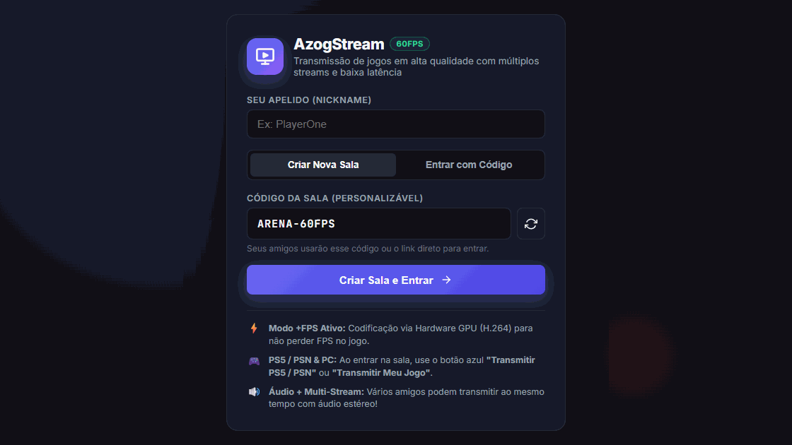

# 🎮 AzogStream `60 FPS` `P2P`

**Plataforma de transmissão de jogos em tempo real com múltiplos streams simultâneos, áudio estéreo de alta fidelidade e latência ultra-baixa via WebRTC.**

 

---

## ⚡ Sobre o Projeto

O **AzogStream** foi desenvolvido para permitir que amigos transmitam suas telas de jogos (PC e PS5/PSN) na mesma sala simultaneamente, sem depender de servidores intermediários pesados que aumentam a latência ou comprimem a qualidade do vídeo.

Utilizando uma **arquitetura Mesh P2P (Peer-to-Peer)** sobre **WebRTC / PeerJS**, o vídeo e o áudio trafegam diretamente entre os participantes com aceleração de hardware via GPU.

---

## ✨ Principais Funcionalidades

- 🚀 **Streaming em 60 FPS Reais (Até 1080p/1440p):** Controle dinâmico de resolução, taxa de quadros (30/60 FPS) e bitrate (até 15 Mbps).
- 🖥️ **Modo +FPS (GPU Hardware Encoding):** Priorização de codec **H.264** via hardware e modo *GPU Saver* no preview local para não consumir recursos enquanto você joga.
- 🎬 **Multi-Stream Simultâneo (Grid & Spotlight):** Vários jogadores podem transmitir suas telas ao mesmo tempo na mesma sala. Alterne entre visão em Grade (Grid) ou Destaque (Spotlight).
- 🎮 **Integração PC + PS5 / PSN:** Suporte nativo a captura de janela/tela no PC com áudio do sistema e integração de embeds ao vivo (Twitch / YouTube) para jogadores no PlayStation 5.
- 🔊 **Áudio Estéreo de Alta Taxa de Bits + Chat de Voz:** Transmissão do som do jogo em estéreo sem filtros destrutivos e canal de microfone independente com *echo cancellation* e *noise suppression*.
- 💬 **Lobby Instantâneo & Chat em Tempo Real:** Crie salas com códigos personalizados (ex: `ARENA-4821`), compartilhe via link direto e converse pelo chat integrado.

---

## 🛠️ Tecnologias Utilizadas

| Camada | Tecnologia |
| :--- | :--- |
| **Core & P2P** | WebRTC (`RTCPeerConnection`, `MediaStream API`), PeerJS |
| **Rede & NAT Traversal** | Multi-STUN Global (Google, Cloudflare, Twilio) com Pool ICE pré-alocado |
| **Frontend** | JavaScript ES6+, HTML5 Semântico, CSS3 Moderno (Custom Properties, Grid/Flexbox) |
| **Deploy & CDN** | Vercel |

---

## 🚀 Como Usar

1. Acesse **[azogstream.vercel.app](https://azogstream.vercel.app)**.
2. Escolha seu **Nickname** e clique em **Criar Sala e Entrar** (ou insira o código da sala de um amigo).
3. Envie o código ou o link direto da sala para seus amigos.
4. Clique em **Transmitir Meu Jogo** (PC) ou **Transmitir PS5 / PSN** e aproveite!

---

  Desenvolvido por <a href="https://github.com/Fabiannss"><strong>Fabiano de Souza (@Fabiannss)</strong></a>

